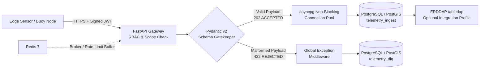

# Secure Defense Telemetry Ingestion Pipeline

A hardened, asynchronous telemetry ingestion gateway built with **FastAPI**, **Pydantic v2**, **Polars**, **asyncpg**, and **PostgreSQL/PostGIS**, paired with **Redis 7** and optional **ERDDAP** (`EDDTableFromDatabase`) integration. Designed for zero-trust edge-to-cloud ingestion, strict runtime schema enforcement, Dead Letter Queue (DLQ) quarantine, CF-1.6 metadata compliance, and automated DevSecOps CI/CD validation.

---

## Architecture Overview



### Core Engineering Decisions
- **Zero-Trust Perimeter & RBAC:** Every `/api/v1/telemetry/submit` request requires a cryptographically signed JWT validated for expiration, role, and `telemetry:submit` scope before touching application logic.
- **Strict Runtime Validation & DLQ Quarantine:** Pydantic v2 enforces strict data types and structural contracts at the API boundary. Malformed payloads are intercepted by global exception middleware, logged with exact validation traces into `telemetry_dlq`, and dropped with `422 Unprocessable Entity` without interrupting concurrent ingestion.
- **Asynchronous Persistence & Dual Drivers:** The FastAPI gateway (`app.main:api_gateway`) manages a native `asyncpg` connection pool across its `lifespan` for non-blocking writes into `telemetry_ingest` and `telemetry_dlq` (`init.sql`), while `psycopg[pool]` and Polars support batch/processing workflows and Redis 7 provides caching, queuing, and rate-limiting support.
- **Zero Hardcoded Secrets:** `pydantic-settings` requires runtime environment injection (`Field(...)` with length validation) with no hardcoded credentials in source control. Local sandbox environments can provision `.env` from `.env.example` (via `cp -n .env.example .env` or `.devcontainer/devcontainer.json`).
- **Hardened Multi-Stage Container:** Built on `python:3.12-slim` with `build-essential` and `libpq-dev` isolated in the builder stage, runtime `libpq5` in `/opt/venv`, non-root execution (`appuser`, UID/GID `10001`), and Uvicorn running `app.main:api_gateway`.
- **Optional Live ERDDAP Integration:** `docker-compose.yml` defines an `erddap` (`erddap/erddap`) service under the `integration` profile that mounts `datasets.xml` and waits for `db` to pass its `pg_isready` healthcheck.

---

## Quick Start (Docker Compose / GitHub Codespaces)

1. **Provision Environment Configuration:**
   ```bash
   cp -n .env.example .env
   ```
   *(Docker Compose reads `.env` automatically; you can also pass `--env-file .env.example` for sandbox runs or configure `.devcontainer/devcontainer.json` on container creation.)*

2. **Build and Launch Core Services (`db`, `redis`, `web`):**
   ```bash
   docker compose up -d --build
   docker compose ps
   ```

3. **Run the Test Suite Inside the Gateway Container:**
   ```bash
   docker compose exec -e PYTHONPATH=. web pytest -v
   ```

4. **Optional — Spin Up Live ERDDAP for Integration Testing:**
   Ensure `datasets.xml` points to your active PostgreSQL host (`db`) and database name (`${POSTGRES_DB}`), then launch with the `integration` profile:
   ```bash
   docker compose --profile integration up -d
   until curl -sf http://localhost:8080/erddap/status.html >/dev/null; do
     sleep 2
   done
   ```
   Tear down the integration profile when finished:
   ```bash
   docker compose --profile integration down
   ```

---

## Test Suite & Verification Summary

### Automated Test Coverage
- **ERDDAP & Schema Alignment (`tests/test_erddap_config.py`):** Parses `datasets.xml`, verifies `EDDTableFromDatabase` connection fields (`driverClassName`, `connectionURL` starting with `jdbc:postgresql://`, `dbUser`, `dbPassword`, `selectString`, and `orderByString`), enforces `CF-1.6` global conventions and coordinate metadata (`time`, `latitude`, `longitude` types and units), and checks SQL queries and `sourceName` references against `telemetry_ingest` in `init.sql` (stripping `--` SQL line comments).
- **Pipeline & Gateway Tests (`test_pipeline.py` / `tests/`):** Validates JWT token signing, `/api/v1/telemetry/submit` ingestion (`202 ACCEPTED`), Pydantic schema enforcement and `telemetry_dlq` quarantine (`422`), auth rejections (`401`/`403`), and Polars batch processing with `PYTHONPATH=.`.

### End-to-End & Load Verification Results

| Verification Test | Test Scenario | Observed Result |
| :--- | :--- | :--- |
| **Live E2E Ingestion** | Authenticated JWT `POST` with valid meteorological payload (`E2E-CLOUD-BUOY-01`) | `202 ACCEPTED`; persisted cleanly into `telemetry_ingest` |
| **DLQ Fault Isolation** | Authenticated `POST` with corrupted timestamp and missing `metrics` (`LIVE-ROGUE-BUOY-99`) | `422 REJECTED_METADATA_VIOLATION`; raw payload and trace quarantined in `telemetry_dlq` |
| **Concurrent Mixed Burst** | 200 shuffled simultaneous requests (140 valid, 45 malformed schema violations, 15 spoofed/unauthorized tokens) | `140` ingested (`202`), `45` quarantined (`422`), `15` blocked at auth perimeter (`401/403`), **0** `500` errors |
| **Restart & Persistence Check** | Stack restart (`docker compose down && docker compose up -d`) and row-count check on `telemetry_ingest` / `telemetry_dlq` | Services healthy (`140` rows in `telemetry_ingest`, `45` rows in `telemetry_dlq` in sample run; use `down -v` for fresh `init.sql` volume reset) |
| **ERDDAP Config & SQL Gate** | `pytest tests/test_erddap_config.py -v` inside `web` | XML structure, CF-1.6 coordinates, and `init.sql` schema alignment verified |
| **DevSecOps CI/CD Gate** | Automated GitHub Actions pipeline (`Ruff`, `Mypy`, `Bandit`, `Pytest`) | Static analysis, type checks, security scans, and test suites passing |

---

## Repository Structure

```text
├── .devcontainer/
│   └── devcontainer.json       # Auto-provisions .env on Codespaces container creation
├── .github/workflows/
│   └── devsecops.yml           # CI/CD pipeline (Ruff, Mypy, Bandit, Pytest)
├── app/
│   ├── auth.py                 # JWT verification and telemetry scope enforcement
│   ├── config.py               # Zero-fallback Pydantic BaseSettings configuration
│   ├── database.py             # asyncpg connection pool & FastAPI lifespan manager
│   ├── main.py                 # FastAPI gateway (api_gateway), /submit endpoint, & DLQ handler
│   └── schemas.py              # Pydantic v2 telemetry payload contracts
├── tests/
│   ├── test_e2e_pipeline.py    # End-to-end API -> PostgreSQL ingestion verification
│   ├── test_erddap_config.py   # ERDDAP datasets.xml, CF-1.6, & init.sql alignment tests
│   └── test_gateway.py         # Auth perimeter & schema boundary unit tests
├── .env.example                # Local sandbox environment variable template
├── datasets.xml                # CF-1.6 compliant ERDDAP EDDTableFromDatabase definition
├── Dockerfile                  # Multi-stage non-root runtime image (/opt/venv, app.main:api_gateway)
├── docker-compose.yml          # db (PostGIS), redis, web (FastAPI), & optional erddap profile
├── init.sql                    # PostgreSQL/PostGIS schema & indexes (telemetry_ingest + telemetry_dlq)
├── main.py                     # Polars vectorized batch processor & gateway utilities
└── requirements.txt            # Runtime & testing dependencies
```
