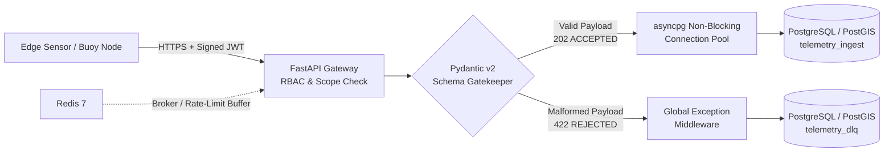

# Secure Defense Telemetry Ingestion Pipeline

A hardened, asynchronous telemetry ingestion gateway built with **FastAPI**, **Pydantic v2**, **Polars**, **asyncpg**, and **PostgreSQL/PostGIS**. Designed for zero-trust edge-to-cloud ingestion, strict runtime schema enforcement, Dead Letter Queue (DLQ) quarantine, and automated DevSecOps CI/CD validation.

---

## Architecture Overview



### Core Engineering Decisions
* **Zero-Trust Perimeter & RBAC:** Every `/api/v1/telemetry/submit` request requires a cryptographically signed JWT validated for expiration, role, and `telemetry:submit` scope before touching application logic.
* **Strict Runtime Validation & DLQ Quarantine:** Pydantic v2 enforces strict data types and structural contracts at the API boundary. Malformed payloads are intercepted by global exception middleware, logged with exact validation traces into `telemetry_dlq`, and dropped with `422 Unprocessable Entity` without interrupting concurrent ingestion.
* **Asynchronous Persistence (`asyncpg`):** Rather than introducing unnecessary operational overhead from a separate background worker tier for single-gateway deployments, the API uses a native `asyncpg` connection pool managed via FastAPI's `lifespan` context for high-throughput non-blocking writes into PostgreSQL/PostGIS (`telemetry_ingest`), while retaining Redis 7 for horizontal scaling and rate-limiting.
* **Zero Hardcoded Secrets:** `pydantic-settings` enforces runtime environment injection (`Field(..., min_length=...)`) with zero fallback credentials in source control. Local development environments auto-provision `.env` from `.env.example` via `.devcontainer/devcontainer.json`.
* **Hardened Multi-Stage Container:** Built on `python:3.12-slim` using an isolated `/opt/venv` virtual environment and executed as a non-root user (`appuser`, UID `10001`).

---

## Quick Start (Docker Compose / GitHub Codespaces)

1. **Provision Environment Configuration:**
   ```bash
   cp .env.example .env
   ```
   *(GitHub Codespaces executes this automatically on container creation.)*

2. **Build and Launch Services (`web`, `db`, `redis`):**
   ```bash
   docker compose up --build -d
   docker compose ps
   ```

3. **Run the Test Suite Inside the Gateway Container:**
   ```bash
   docker compose exec -e PYTHONPATH=. web pytest -v
   ```

---

## End-to-End Verification & Load Testing Summary

Prior to deployment, the containerized stack was validated across functional, persistence, and concurrent stress scenarios:

| Verification Test | Test Scenario | Observed Result |
| :--- | :--- | :--- |
| **Live E2E Ingestion** | Authenticated JWT `POST` with valid meteorological payload (`E2E-CLOUD-BUOY-01`) | `202 ACCEPTED`; persisted cleanly into `telemetry_ingest` |
| **DLQ Fault Isolation** | Authenticated `POST` with corrupted timestamp and missing `metrics` (`LIVE-ROGUE-BUOY-99`) | `422 REJECTED_METADATA_VIOLATION`; raw payload and trace quarantined in `telemetry_dlq` |
| **Concurrent Mixed Burst** | 200 shuffled simultaneous requests (140 valid, 45 malformed schema violations, 15 spoofed/unauthorized tokens) | `140` ingested (`202`), `45` quarantined (`422`), `15` blocked at auth perimeter (`401/403`), **0** `500` errors |
| **Volume Reboot Persistence** | Full container teardown and restart (`docker compose down && docker compose up -d`) | **100% row retention** (`142` rows in `telemetry_ingest`, `46` rows in `telemetry_dlq`) across restarts |
| **DevSecOps CI/CD Gate** | Automated GitHub Actions pipeline (`Ruff`, `Mypy`, `Bandit`, `Pytest`) | All static analysis, AST security audits, and unit/integration suites passing |

---

## Repository Structure

```text
├── .devcontainer/
│   └── devcontainer.json       # Auto-provisions .env and dev dependencies in Codespaces
├── .github/workflows/
│   └── devsecops.yml           # CI/CD pipeline (Ruff, Mypy, Bandit, Pytest)
├── app/
│   ├── auth.py                 # JWT verification and telemetry scope enforcement
│   ├── config.py               # Zero-fallback Pydantic BaseSettings configuration
│   ├── database.py             # asyncpg connection pool & FastAPI lifespan manager
│   ├── main.py                 # FastAPI gateway, /submit endpoint, & DLQ middleware
│   └── schemas.py              # Pydantic v2 telemetry payload contracts
├── tests/
│   ├── test_e2e_pipeline.py    # Live end-to-end API -> PostgreSQL verification
│   ├── test_erddap_config.py   # ERDDAP datasets.xml metadata validation
│   └── test_gateway.py         # Auth perimeter & schema boundary unit tests
├── .env.example                # Safe environment variable template
├── datasets.xml                # CF-1.6 / COARDS compliant ERDDAP dataset definition
├── Dockerfile                  # Multi-stage non-root runtime image (/opt/venv)
├── docker-compose.yml          # PostGIS, Redis, and FastAPI service orchestration
├── init.sql                    # PostgreSQL/PostGIS schema & indexes (ingest + DLQ)
├── main.py                     # Polars vectorized batch processor & gateway utilities
└── requirements.txt            # Pinned runtime & testing dependencies
```
