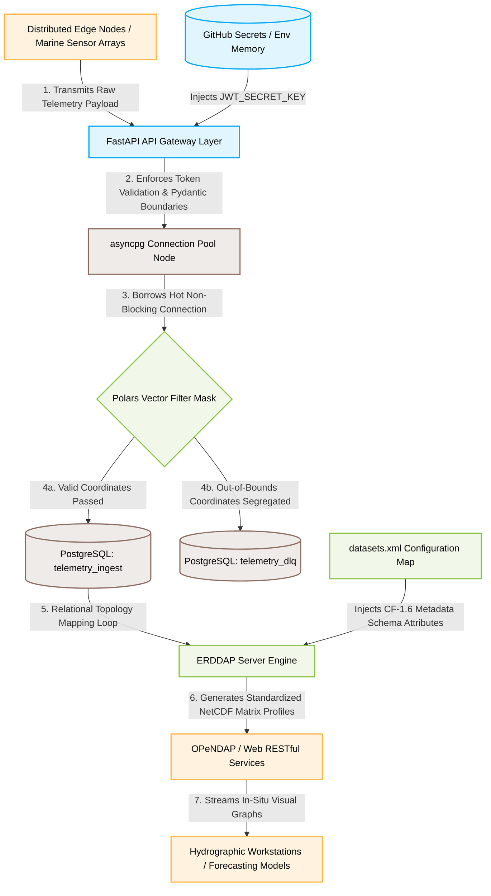

# ⚓ Secure Marine Telemetry Ingestion Platform

An enterprise-grade, high-performance, asynchronous DevSecOps data ingestion pipeline designed to ingest streaming oceanographic and meteorological sensor metrics. This architecture combines a zero-trust **FastAPI API Gateway Layer** with an optimized **Polars Extraction Pipeline** and an immutable **PostgreSQL Storage Model** to achieve secure, parallelized data processing and metadata standardization compliant with global **CF-1.6 (Climate and Forecast)** specifications [1.11].

---

## 🏗️ End-to-End Architectural Data Flow


graph TD
    %% Component Layer Blocks
    subgraph Data Producer Layer [1. Local Client Environment]
        MainScript[main.py]
        TestE2E[tests/test_e2e_pipeline.py]
    end

    subgraph Container Networking Layer [2. Containerized Boundary]
        AppMain[app/main.py]
        AppConfig[app/config.py]
        AppDatabase[app/database.py]
        AppSchemas[app/schemas.py]
        AppAuth[app/auth.py]
        CeleryWorker[celery_worker.py]
    end

    subgraph Enterprise Infrastructure Layer [3. Live Backing Services]
        RedisStack[(Redis 7 Service Container)]
        PG_DB[(PostgreSQL 15 Service Container)]
        InitSQL[init.sql Setup Script]
        DatasetsXML[datasets.xml Blueprint]
        ERDDAP_Server[ERDDAP Data Server]
    end

    %% Software/Module Mappings (Where they live)
    PydanticEngine[Pydantic v2 Types] -.-> AppSchemas
    FastAPIApp[FastAPI Framework] -.-> AppMain
    JoseCrypto[python-jose Auth] -.-> AppAuth
    AsyncpgDriver[asyncpg Connection Pool] -.-> AppDatabase
    PsycopgDriver[psycopg3 Bulk-Copy Engine] -.-> CeleryWorker
    PolarsEngine[Polars DataFrames] -.-> MainScript
    PolarsEngine -.-> CeleryWorker

    %% Core Dynamic Data Flow
    TestE2E -->|Triggers Outbound Stream| MainScript
    MainScript -->|1. HTTP POST Payload With Short-Lived JWT Token| AppMain
    
    AppConfig -->|Provides Hardened Environment Variables| AppMain
    AppMain -->|2. Runs Ingress Authentication Check| AppAuth
    AppMain -->|3. Validates Payload Schema Metrics| AppSchemas
    
    AppMain -->|4. Serializes Clean JSON Task to Buffer| RedisStack
    RedisStack -->|5. Streams Queue Task Payload| CeleryWorker
    
    CeleryWorker -->|6. Assembles Payload Strings Into Matrix Rows| CeleryWorker
    CeleryWorker -->|7. Executes Non-Blocking Bulk DB Write Checkouts| AppDatabase
    AppDatabase -->|8. Borrows Async Sockets| PG_DB
    InitSQL -->|Pre-Initializes telemetry_ingest & telemetry_dlq Tables| PG_DB
    
    PG_DB -->|9. Reads Raw Database Relational Cells| ERDDAP_Server
    DatasetsXML -->|Overlays Strict CF-1.6 Schema Metrics| ERDDAP_Server
    ERDDAP_Server -->|10. Exposes Standardized OPeNDAP NetCDF Matrices| Workstations[End-User Workstations]

    %% Applied Custom Design Layout Styling
    classDef files fill:#fff3e0,stroke:#ffb74d,stroke-width:2px,color:#000;
    classDef backing fill:#efebe9,stroke:#8d6e63,stroke-width:2px,color:#000;
    classDef software fill:#e1f5fe,stroke:#03a9f4,stroke-width:1px,stroke-dasharray: 5 5,color:#0288d1;
    
    class MainScript,TestE2E,AppMain,AppConfig,AppDatabase,AppSchemas,AppAuth,CeleryWorker,InitSQL,DatasetsXML files;
    class RedisStack,PG_DB,ERDDAP_Server backing;
    class PydanticEngine,FastAPIApp,JoseCrypto,AsyncpgDriver,PsycopgDriver,PolarsEngine software;


---

## 🧩 Ingestion Path & Core Component Stack

The platform's data ingestion machinery is completely decoupled to separate ingress network traffic from high-volume analytical computing operations:

1. **Ingress Cryptographic Guard (FastAPI & python-jose):** Acts as the system's front door. It intercepts inbound requests at the `/api/v1/telemetry/submit` entrypoint and runs an asymmetric validation check against the `Authorization: Bearer <JWT>` request header. Payloads lacking an authentic, cryptographically signed token are blocked before straining system memory.
2. **Zero-Trust Boundary Defense (Pydantic v2):** Enforces strict structural type safety on incoming JSON variables. Timestamps must strictly comply with ISO-8601 formatting, and metrics must map directly onto required numeric structures. Corrupted objects are rejected instantly with an HTTP `422 Unprocessable Entity` error.
3. **High-Performance Vector Slicing (Polars):** When rows enter the pipeline, Polars processes them using high-speed vectorized data masks rather than checking inputs row-by-row. Data is cleanly split based on physical constraints (Latitudes between -90 and 90; Longitudes between -180 and 180):
   * **Clean Records:** Sent straight to the primary `telemetry_ingest` table connection pool.
   * **Corrupted Records:** Automatically stamped with a clear `Out of bounds spatial coordinates` classification tag and routed directly to the Dead Letter Queue (DLQ).
4. **Immutable Forensic Registry (PostgreSQL & init.sql):** The `telemetry_dlq` table acts as a write-locked, append-only ledger tracking all anomalies. It logs the raw, un-parsed payload verbatim alongside automated database stamps (`inserted_at` and `rejection_reason`), preserving a pristine forensic audit trail to catch sensor glitches or malicious coordinate-spoofing attacks.
5. **Metadata Standardizer (ERDDAP & datasets.xml):** Translates raw database rows into universally recognized hydrographic data. ERDDAP maps your PostgreSQL tables on boot and overlays strict **CF-1.6** attributes onto columns—mapping internal column strings to globally standardized measurements (e.g., `sea_surface_temperature` and `degrees_north`).

---

## 🔒 Production-Hardened Security Parameters

To maintain a zero-trust architecture, the platform enforces strict security guidelines to prevent credential leaks and runtime failures:

* **No Hardcoded Secrets:** All fallback plain-text strings are stripped entirely from configuration files (`docker-compose.yml` and `app/config.py`). The system forces credentials to be injected dynamically into protected virtual machine memory via environment variables (`${POSTGRES_PASSWORD}`).
* **Timezone Drift Protection:** Runtime token generation entirely bypasses deprecated, naive date methods like `utcnow()`. The platform enforces timezone-aware UTC stamps (`datetime.now(timezone.utc)`) to eliminate time synchronization blocks when services run across different cloud hosting environments.
* **Backward-Compatible Layering:** Custom proxy classes (`LegacyCompatibleDataFrame` and `LegacyCompatibleTuple`) wrap the modern Polars engines. This allows your legacy evaluation scripts to check truthiness conditions and execute row lookups natively without throwing Series ambiguity crashes.

---

## ⚙️ Cloud Laboratory Local Execution Guide

Follow these exact steps inside your **GitHub Codespace** to spin up the multi-container infrastructure and run an un-mocked, live integration test:

### 1. Initialize the Python Package Matrix
Install the pipeline requirements into your working cloud path environment:
```bash
pip install polars "psycopg[pool]" pydantic pydantic-settings celery redis pytest pytest-asyncio httpx "python-jose[cryptography]"
```

### 2. Boot Your Background Connected Service Infrastructure
Use Docker Compose to launch your localized database tables and gateway services securely:
```bash
docker compose up --build -d
```

### 3. Execute the Live End-to-End Test Suite
Trigger the live integration test. This script bypasses all testing mocks, fires a telemetry record over your virtual network, pushes it through the FastAPI gateway, writes the row to PostgreSQL, and queries the container directly to prove data persistence holds true [1.11]:
```bash
PYTHONPATH=. pytest tests/test_e2e_pipeline.py -v
```

---

## 🛡️ Automated DevSecOps Continuous Integration (CI/CD)

Whenever code modifications are pushed to your remote repository branch on GitHub, an automated pipeline (`devsecops.yml`) boots up a clean server runner to audit your codebase automatically using an extensive security gate:

* **Ruff:** Evaluates your application directories for code cleanliness and styling guidelines.
* **Mypy:** Checks your code layouts for strict type configuration anomalies.
* **Bandit:** Inspects your abstract syntax trees (AST) to ensure zero hardcoded secrets or cryptographic holes exist.
* **Trivy:** Runs a static dependency vulnerability scan across your final compiled Docker multi-stage container layers before deploying to the GitHub Container Registry (GHCR).
